# Вайбкод — это смерть?

Черновик доклада на пятницу, 6 ноября. Провокационный ответ на доклад коллеги «Вайбкод — это жизнь?». О чём: ограничения вайбкода, зрелые подходы и где они уже работают — в разработке и за её пределами: инфра-опс, личный ассистент, саппорт.

Текст ниже — то, что я говорю. Слайд стоит перед абзацем, с которого я его показываю, и висит до следующего слайда.

**Слайд 1. Вайбкод — это смерть?**

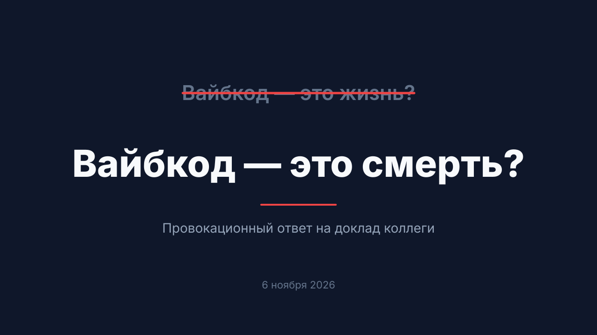

Коллега спросил, жизнь ли это. Я отвечу: **смерть**. Причём тройная: мозга, кошелька и проекта. А в конце расскажу, есть ли жизнь после смерти. Спойлер: есть, но в неё не попадают просто так, по вайбу.

## 1. Как возникло явление

Сначала агентов не было. Была генерация кода: жмёшь Tab, и модель дописывает строчку. Сам Tab, кстати, не новость: IntelliSense от Microsoft подсказывал по нему ещё в Visual Studio 2010, а появился и вовсе в 1996-м. Только IntelliSense подставлял имена из проекта, а модель дописывает код по смыслу. Затем инлайн-команды: выделяешь функцию, пишешь «перепиши без цикла», получаешь диф. Или копируешь куски из чата туда и обратно. **Программировал всё ещё человек**, модель была умным автокомплитом.

**Слайд 2. Few-shot: учим примерами, а не правилами**

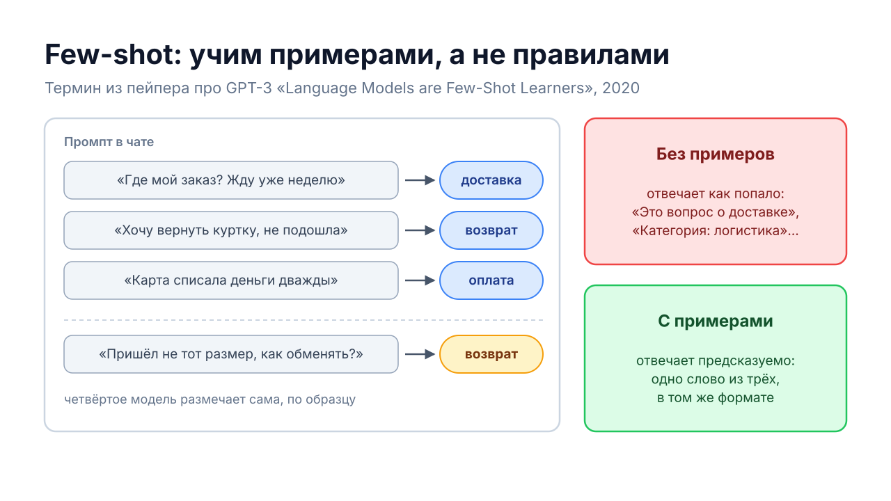

Параллельно в чате мы освоили **few-shot**. Это когда модели не объясняешь задачу правилами, а показываешь несколько примеров «вход → выход» прямо в промпте, и она продолжает по образцу. Термин пришёл из пейпера про GPT-3 2020 года, «Language Models are Few-Shot Learners». Работало это так: вставляешь в чат три обращения клиентов с готовой разметкой «доставка», «возврат», «оплата», и четвёртое модель размечает сама. Или даёшь пару образцов ответа в нужном тоне и формате и получаешь третий такой же. **Без примеров модель отвечала как попало, с примерами — предсказуемо.**

**Слайд 3. Цепочка вызовов: выход шага — вход следующего**

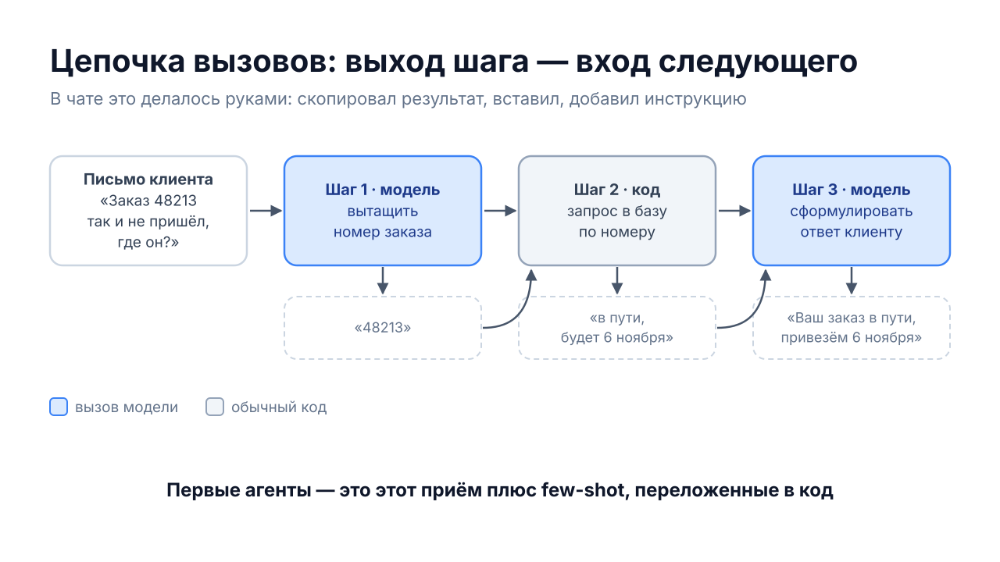

Второй приём из чата — **цепочки вызовов**. Большую задачу режешь на шаги, и выход одного вызова становится входом следующего: сначала вытащить из письма номер заказа, потом сходить с ним в базу, потом сформулировать ответ. В чате это делалось руками: скопировал результат, вставил в следующее сообщение, добавил инструкцию.

Первые агенты — это ровно эти два приёма, переложенные в код. Появились они почти одновременно с ChatGPT, в конце 2022-го. Пейпер ReAct в октябре показал, что модель может чередовать рассуждение и действие, и учили её этому тоже few-shot: в промпт вставляли пару образцов трасс «мысль → действие → наблюдение». LangChain вышел в том же октябре, за месяц до ChatGPT, и упаковал всё это в библиотеку: шаблоны промптов с примерами, цепочки вызовов, роутеры между ними. В декабре туда добавили агентов на основе ReAct, а в марте 2023-го вышел AutoGPT.

**Слайд 4. Чат-бот поддержки интернет-магазина на LangChain, 2023**

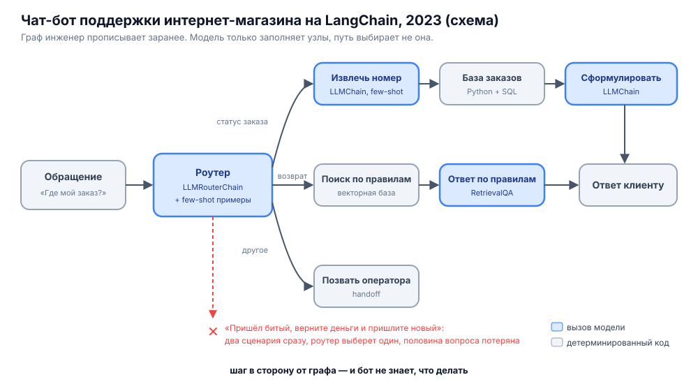

Так началась эра LangChain и подобных: инженер прописывает flow, агент решает одну специфическую задачу. **Я бы назвал таких агентов жёсткими, ригидными**: они подчиняются детерминированному сценарию по графу, а модель только заполняет узлы. Типичный пример — чат-бот поддержки интернет-магазина образца 2023 года. Роутер с few-shot примерами решает, куда отправить обращение. Для статуса заказа одна цепочка вытаскивает номер, обычный код идёт в базу, вторая цепочка формулирует ответ. Для возврата — поиск по базе правил и ответ по найденному. Всё остальное уходит оператору.

Пока клиент спрашивает по сценарию, всё работает. Но обращение «пришёл битый, верните деньги и пришлите новый» — это два сценария сразу, а роутер выберет один. **Половина вопроса теряется, и граф ничего не может с этим сделать**: пути, которого инженер не нарисовал, для бота не существует.

**Слайд 5. Как менялись агенты: от жёстких графов к агентам без сценария**

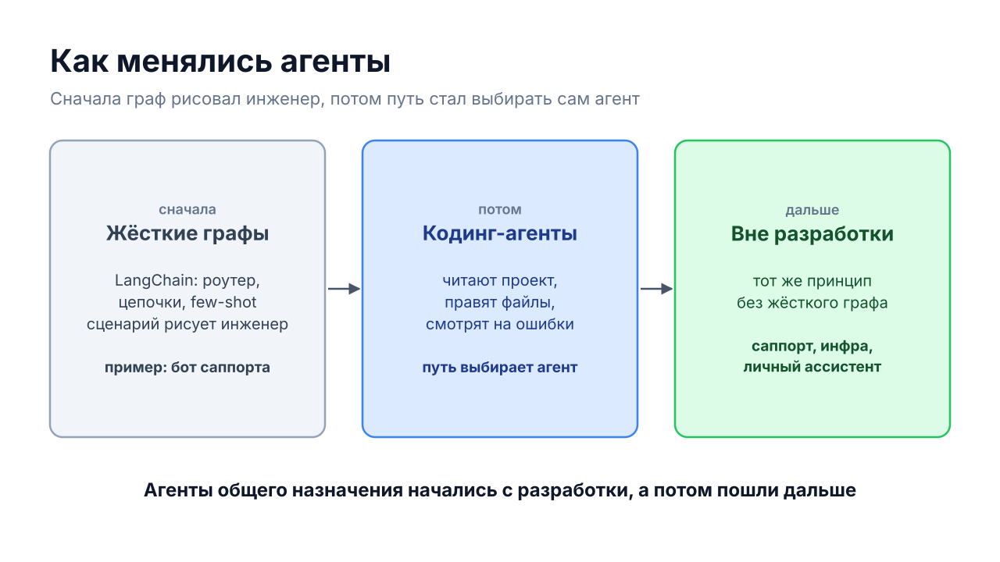

Так агентов сначала и делали: под каждую прикладную задачу инженер собирал на LangChain свой граф, и саппорт был самым частым случаем. **Потом появились агенты общего назначения, и первыми из них стали кодинг-агенты.** Они сами читают проект, правят файлы, запускают команды и смотрят на ошибки. Жёсткого сценария больше нет: путь агент выбирает сам. Позже этот принцип вышел за пределы разработки: такие же агенты без графа взялись за инфраструктуру, поддержку и личные дела. Об этом я расскажу в конце.

Но первым делом сдвиг случился в разработке. Прототип, который худо-бедно работает, можно собрать **без технической спеки, без архитектуры, без SDLC**. Просто накидываешь агенту свой вайб на естественном языке: «сделай красиво», «нет, не так», «ну вот, почти».

**Слайд 6. Один цикл, разные датчики: от вайбкода к зрелому подходу**

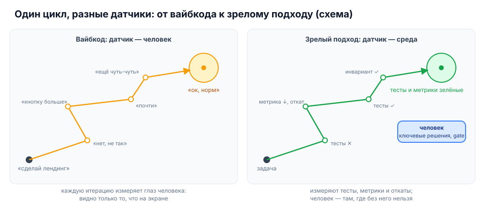

Здесь важно зафиксировать один момент. **В вайбкоде human in the loop работает как элемент обратной связи.** Каждое «нет, не так» — это измерение, и по нему агент шаг за шагом приближает решение к желаемому. Это тот же цикл, что у агентов, которые брутфорсят решение с обратной связью без человека: шаг, измерение, поправка, следующий шаг. **Отдельный шаг случаен, но траектория в целом сходится.** Только датчиком в вайбкоде работает человек.

**Зрелые подходы — это эволюция из вайбкода, а не его отрицание.** Цикл остаётся, меняется датчик: вместо глаза человека — тесты, метрики, стенд и откаты. А сам человек уходит туда, где без него не обойтись.

**Слайд 7. Явление появилось раньше, чем название**

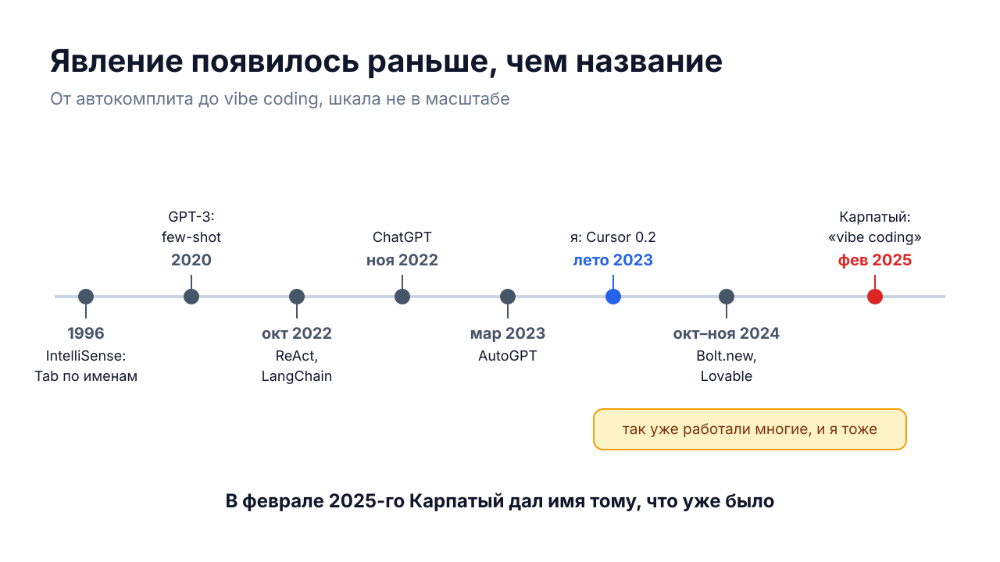

В феврале 2025-го Андрей Карпатый дал этому имя: vibe coding. Отдаться вайбу и забыть, что код вообще существует. **Название появилось позже, чем само явление**: к тому моменту так уже работали многие, и я в том числе.

## 2. Моё знакомство с агентной разработкой

Фриланс был моим источником заработка ещё до агентов. Мелкие проекты для малого бизнеса, что угодно: сайты, приложения, DDoS-файрволы и фильтры, микросервисы, небольшие программы под конкретную задачу клиента. **Обычная жизнь фрилансера**: сколько успел сделать руками, столько и заработал.

**Слайд 8. Как менялась моя роль**

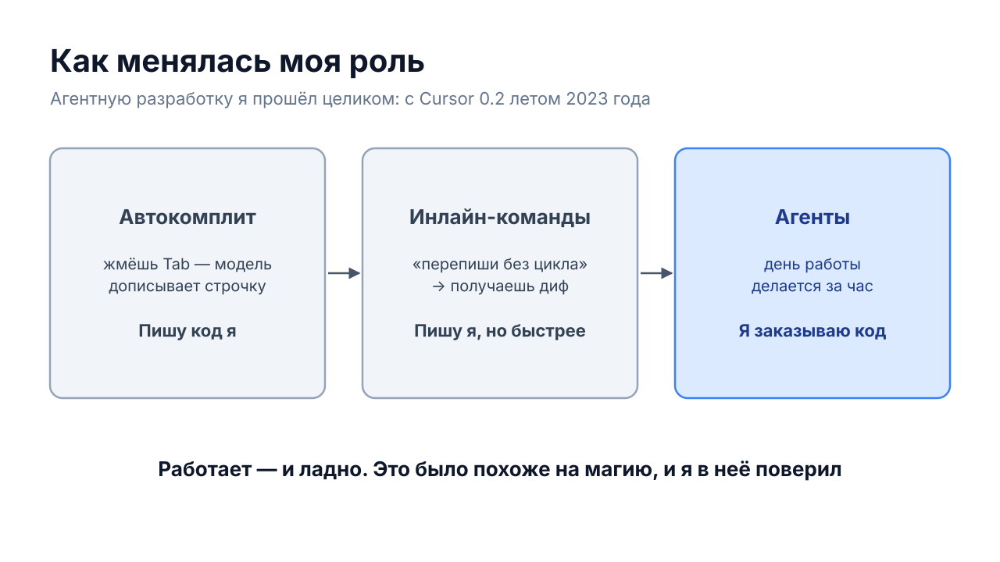

Агентную разработку я прошёл целиком, с самого начала. **Начал с Cursor версии 0.2 летом 2023 года.** Сначала автокомплит и инлайн-команды: это всё ещё я пишу код, просто быстрее. Ощущение было как от хорошей IDE, не больше. Но буст уже огромный: очень весомая часть рутины просто отпала.

Первые агенты ощущались совсем иначе. **Я перестал писать код и начал его заказывать.** То, на что раньше уходил день, делалось за час. Не нужно проектировать, не нужно толком читать, что получилось: работает — и ладно. Это было похоже на магию, и я в неё поверил.

## 3. 2024 год: секретный взлёт

В 2024 году случился резкий взлёт. И главное в нём то, что **я был в этом один.** Про Cursor я не рассказывал никому, кроме самых достойных. Зачем раздавать конкурентам оружие, которое даёт тебе фору?

**Слайд 9. 2024: секретный взлёт**

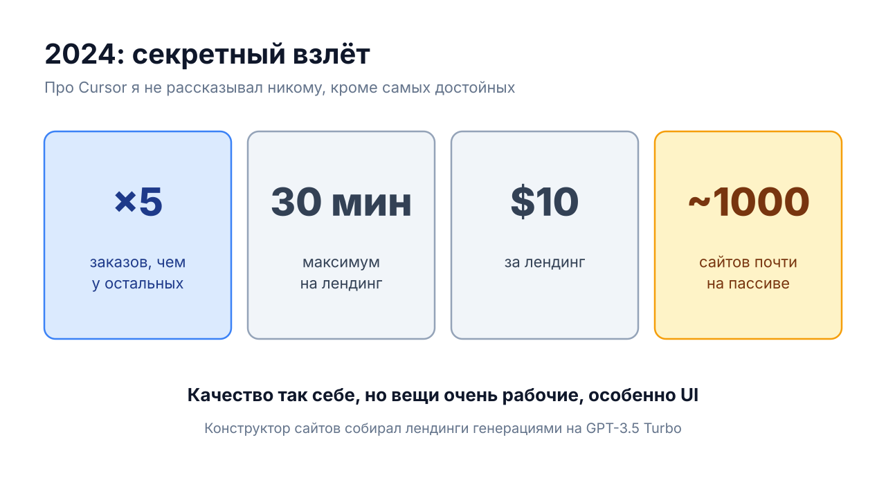

Фора была огромной: **я забирал в пять раз больше заказов, чем остальные**, и успевал их сделать. Конкурентов с такой скоростью на рынке просто не было: большинство ещё писало код руками.

Качество было так себе, и я это знал. Но вещи получались **очень рабочие**, особенно UI: интерфейсы агенты уже тогда делали классно, а заказчик видит именно интерфейс. Лендинги шли потоком, и дошло до собственного конструктора сайтов.

Конструктор собирал лендинг генерациями на GPT-3.5 Turbo (в API это `gpt-3.5-turbo`, в 2024-м под ним стоял снапшот `gpt-3.5-turbo-0125`), **максимум за 30 минут**. Продавал я их **по 10 долларов**. Копейки? Конструктор выдал под тысячу сайтов, и всё это работало **почти полностью на пассиве**.

А потом появились Bolt.new в октябре 2024-го и Lovable в ноябре, а за ними и остальные. Клиент теперь мог собрать себе лендинг сам, прямо в браузере. Пошло adoption в массы, и **моё преимущество начало таять**.

## 4. Эйфория и дешёвый дофамин

Дальше секрет окончательно перестал быть секретом. Вайбкод захлестнул всех. Лента забилась постами «сделал SaaS за выходные без единой строчки кода». **Казалось, что программировать больше не нужно**, а программисты — следующий вымирающий вид.

**Слайд 10. Игровой автомат, только вместо жетонов — токены**

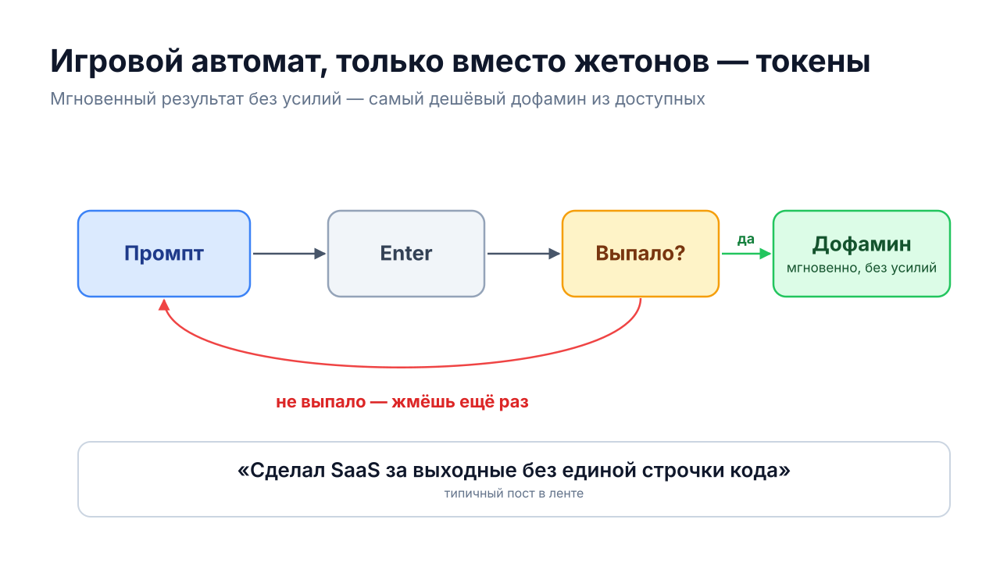

Механика простая и знакомая: написал промпт, нажал Enter, смотришь, выпало или нет. Не выпало — жмёшь ещё раз. **Это игровой автомат**, только вместо жетонов токены. Мгновенный результат без усилий — самый дешёвый дофамин из доступных.

При этом надо честно признать: получалось. Небольшие программы, внутренние тулзы, прототипы, иногда реально полезные бизнесу, если применить с умом. **Поделки, низкокачественные, но рабочие.** Вайбкод давал плоды. Только собирал их теперь не я один, а все.

## 5. Как вайбкод убил меня

**Слайд 11. Вайбкод меня сначала озолотил, а потом убил**

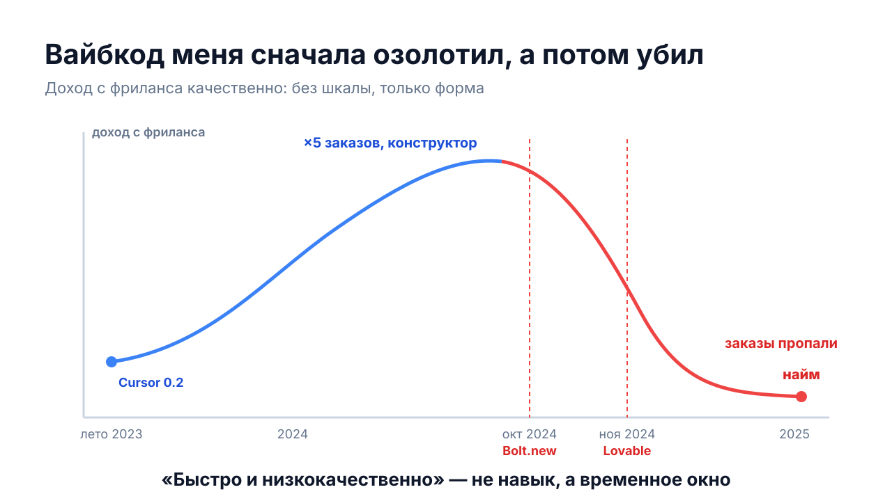

**Вайбкод меня сначала озолотил, а потом убил.** То, что давало мне преимущество, очень быстро стало массовым. Порог входа упал до нуля. Школьники вайбкодят практически бесплатно: им не нужно на это жить, и по цене с ними не конкурировать.

Рынок рухнул. Первым умер конструктор: кто купит лендинг за 10 долларов, если Lovable соберёт его бесплатно за пять минут. Следом обесценились и остальные мелкие проекты, на которых я жил: зачем платить фрилансеру за сайт или микросервис, если «нейросеть сама сделает». **Заказы у меня просто пропали.** Не стало меньше, а именно пропали.

Уровень жизни упал. И мне, фрилансеру, который ещё вчера делал в пять раз больше всех, **пришлось идти на работу в найм.** Это и есть первая смерть, которую я пережил лично, а не в теории.

Вывод неприятный: **«быстро и низкокачественно» — не навык, а временное окно.** Пока так умеешь только ты, это преимущество. Когда так умеют все, это просто нижняя планка рынка, и стоит она копейки. Если честно, **я сам был тем школьником с вайбкодом, только на год раньше.**

## 6. Большие продукты и предел вайбкода

**Слайд 12. Две недели — восторг, на третий месяц — болото**

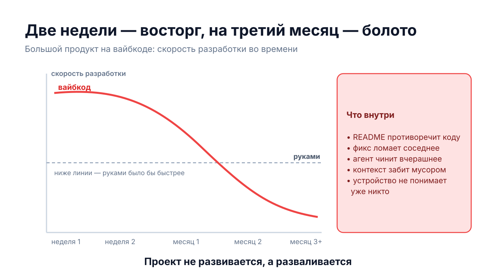

Второй удар пришёл с другой стороны. Лендинг живёт неделю, а большой продукт разрабатывают месяцами и годами. И тут вайбкод упирается в потолок. **Первые две недели — восторг, на третий месяц — болото.**

Репозиторий превращается в **кашу из слабо связанных документов, которые противоречат коду** и друг другу. Агент сам написал README, сам его забыл и сам ему противоречит. Каждый фикс ломает два других места, агент чинит то, что сломал вчера, контекст забит устаревшим мусором. Спеки, как будет видно дальше, эту кашу не лечат, а только меняют её форму.

И наступает момент, когда **агент не ускоряет разработку, а замедляет её**. Руками было бы быстрее. Только руками уже никто не может: никто не понимает, как это всё устроено. Проект не развивается, а разваливается.

## 7. Вайбкод — это смерть

**Слайд 13. Уровни использования ИИ**

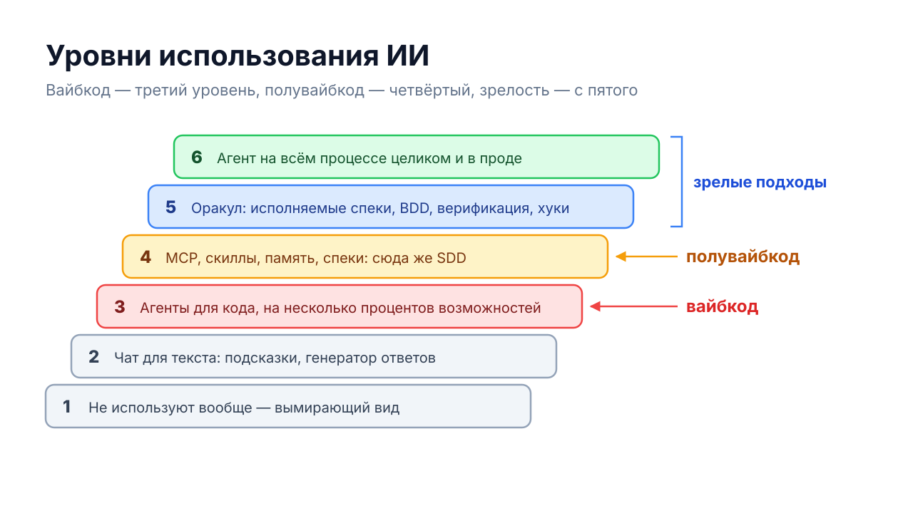

Использование ИИ я раскладываю по уровням:

1. Не используют вообще — вымирающий вид.
2. Чат для работы с текстом: подсказки, генератор ответов.
3. Агенты для кода, но на несколько процентов от их возможностей.
4. MCP, скиллы, память, спеки: повторяющееся фиксируют и переиспользуют.
5. Агентные воркфлоу: петли обратной связи, верификация, хуки и тесты как оракул — исполняемые спеки и BDD-сценарии, закрытые от правок агента. Но на агента замыкают только фрагменты процесса.
6. Дальше — агент на всём процессе целиком и агенты в проде.

Вайбкод — это третий уровень. **Делегируют агенту мышление** и дают ему бесконтрольно выполнять большие блоки задач. Четвёртый — всё ещё вайбкод, только **полувайбкод**: MCP, скиллы и спеки делают агента автономнее, но проверяет результат по-прежнему человек на глаз. Сюда же попадает spec-driven development, о нём дальше. **Зрелые подходы начинаются только с пятого уровня.** А до него это не инженерия, а слабоумие и отвага. И у неё три исхода.

**Слайд 14. Три исхода вайбкода**

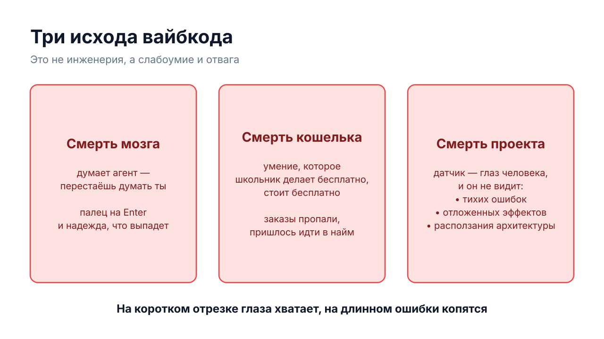

**Смерть мозга.** Когда думает агент, ты перестаёшь думать сам. Сначала не читаешь код, потом не понимаешь, что он делает, потом не можешь сформулировать, чего хочешь. Остаётся палец на Enter и надежда, что в этот раз выпадет. **Отупение от дешёвого дофамина — самый тихий и самый реальный эффект.**

**Смерть от голода и бедности.** Это не метафора, я через неё прошёл: заказы пропали, уровень жизни упал, пришлось идти в найм. Если твоё умение — то, что бесплатно делает любой школьник, то и стоит оно бесплатно. На вайбкоде можно было заработать в окне 2024 года. **Сейчас на нём не заработаешь ничего, кроме выгорания.**

**Смерть проекта.** Стремительный взлёт, яркая вспышка, демо в соцсетях — и конец. Цикл обратной связи в вайбкоде есть, но **датчик в нём — глаз человека.** Он видит кнопку на экране, но не видит тихих ошибок, когда всё зелёное, а данные испорчены. Не видит отложенных эффектов, которые всплывают через час или под ночной нагрузкой. И не видит архитектуры, которая расползается с каждым «почти». Поэтому UI вайбкодится отлично, а большой продукт гниёт изнутри. На коротком отрезке глаза хватает, на длинном ошибки накапливаются, и дальше вайбкода проект не двинется.

**Слайд 15. Бот поддержки по вайбу**

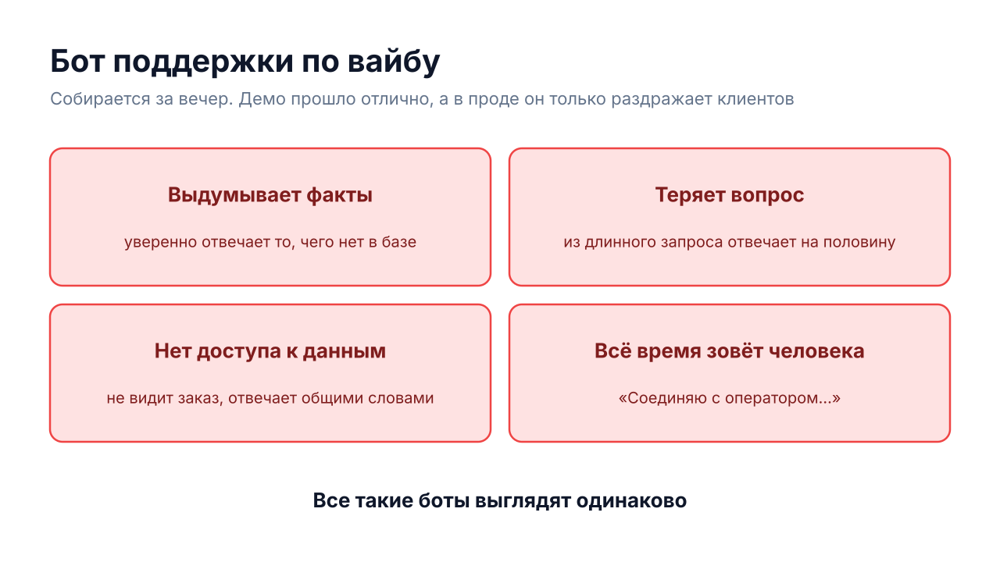

Нагляднее всего это видно на ботах в саппорте. Собрать такого по вайбу можно за вечер, и выглядят они все одинаково: **выдумывают факты, теряют вопрос из длинного запроса, не имеют доступа к данным и всё время зовут человека.** Демо прошло отлично, а в проде бот только раздражает клиентов.

## 8. Агент как инструмент

Двигало меня не любопытство и не любовь к красивой инженерии. **Двигал в первую очередь страх голода и бедности.** Когда заказы пропадают, быстро понимаешь: либо учишься делать то, что школьник с вайбкодом не сделает, либо остаёшься на нижней планке рынка.

**Слайд 16. Агент — не магия, а инструмент**

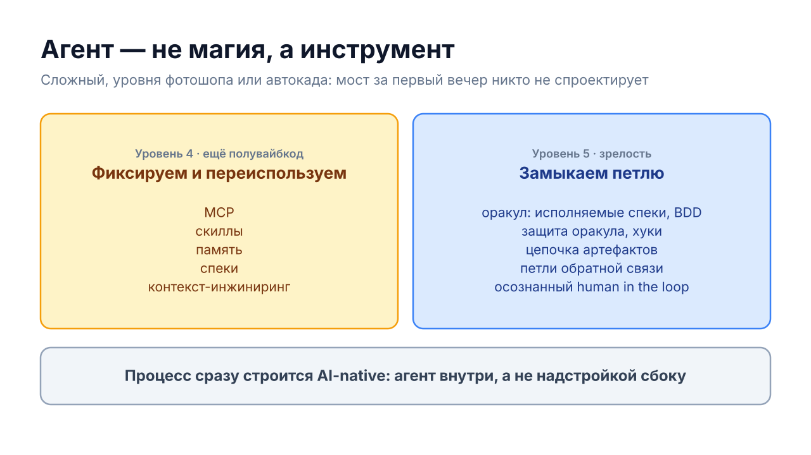

Пришлось подключить голову. И признать простую вещь: **агент — не магия, а инструмент.** Сложный, уровня фотошопа или автокада. Никто не ждёт, что кто-то откроет автокад в первый раз и вечером спроектирует мост.

Дальше классический путь освоения инструмента. Изучать техники и методы, разбираться, какие есть функции, пробовать, совмещать, набивать шишки. Перепробовать весь спектр: от голого Claude до n8n, LangChain и собственного supagent. MCP, скиллы, память, контекст-инжиниринг — это четвёртый уровень, и сам по себе он ещё полувайбкод. **Зрелость начинается с пятого**: тестовая среда, верификация, хуки, петли обратной связи, осознанный human in the loop. А шестой — агент на всём процессе целиком.

**Слайд 17. Тесты на пятом уровне — это оракул**

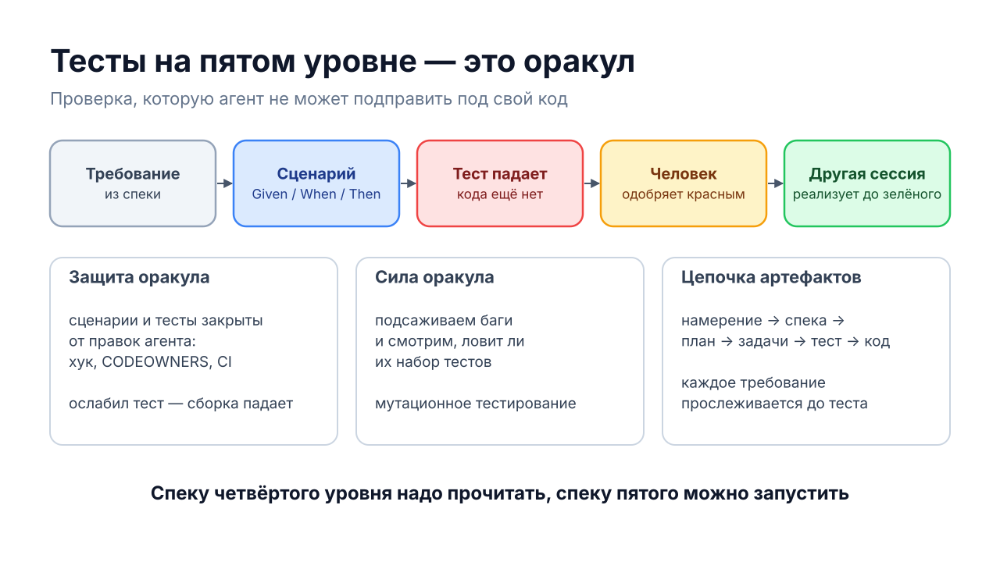

Тесты на пятом уровне значат не то, что обычно. Тест, который агент сам написал после кода, описывает этот код вместе с его багами и проходит по построению. Нужен **оракул** — проверка, которую агент не может подправить под себя. Спека становится исполняемой: в духе behavior-driven development каждое требование превращается в сценарий Given/When/Then, из сценариев генерируются тесты, и они падают ещё до того, как появился код. Человек одобряет сценарии, пока они красные, а реализацию до зелёного ведёт отдельная сессия. Оракул защищают: сценарии и тесты закрыты от правок агента хуком, CODEOWNERS и проверкой в CI, а удалённая проверка или новый skip роняют сборку. Силу оракула меряют: подсаживают баги и смотрят, ловит ли их набор тестов. Всё вместе складывается в **цепочку артефактов**: намерение, спека, план, задачи, тесты, код, и каждое требование прослеживается до своего теста. **Спеку четвёртого уровня надо прочитать, спеку пятого можно запустить.**

И отдельно пришлось переучиться думать. Агента нельзя прикрутить надстройкой к старому процессу и ждать чуда. **Процесс нужно сразу строить AI-native**, с агентом внутри, а не сбоку.

Скучно? Да. Дофамина меньше? Намного. **Но именно здесь агент начинает ускорять разработку на длинной дистанции, а не только на первой неделе.**

## 9. Есть ли жизнь после смерти

**Слайд 18. Разница не в коде: доверие — свойство системы**

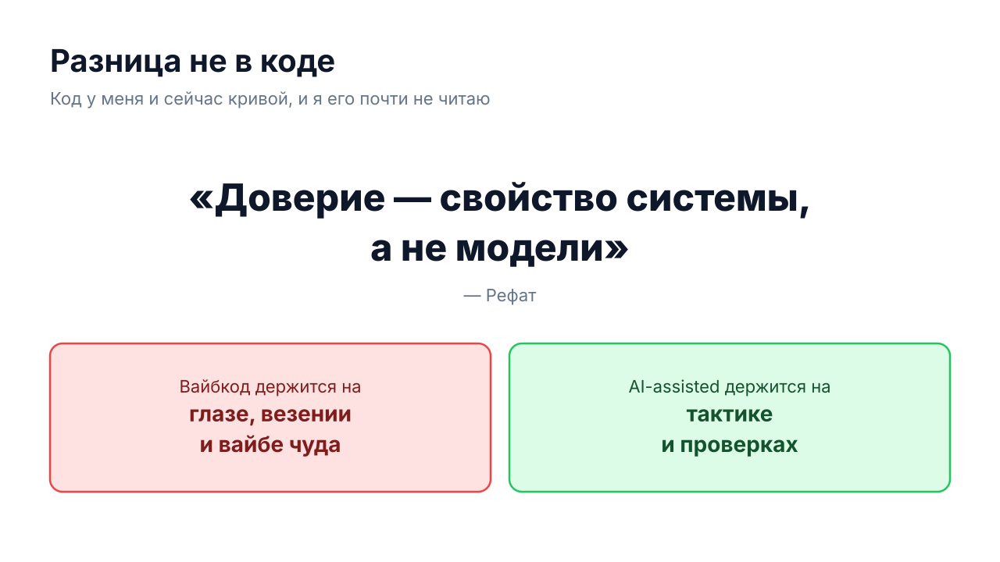

Есть. Это **AI-assisted разработка**. И вот главный парадокс: код у меня и сейчас кривой, и я его почти не читаю. Говнокод, как и раньше. **Разница не в коде.**

Разница в том, что вокруг него. Вайбкод держится на глазе человека, на везении и на том самом вайбе чуда. AI-assisted разработка — на **доверии, основанном на тактике и проверках**. Как точно сформулировал Рефат в [своём посте](https://t.me/nobilix/277), **доверие — свойство системы, а не модели.** Модели не нужно верить на слово: нужна система, в которой её ошибка ничего не ломает.

**Слайд 19. Цикл обратной связи агента: сделать — измерить**

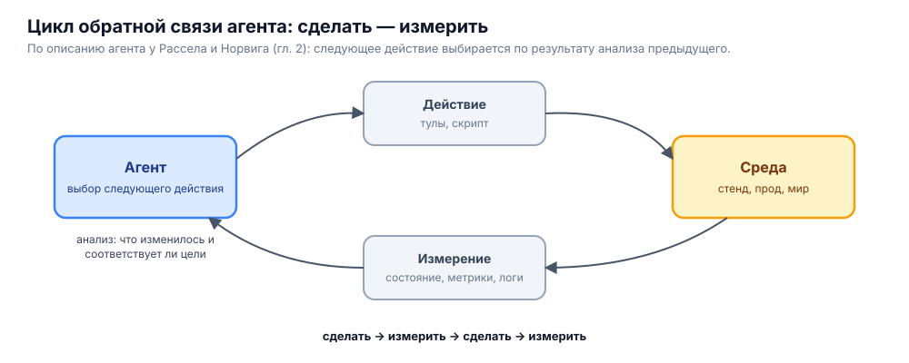

Что такое агент, ещё в 1995 году сформулировали Стюарт Рассел и Питер Норвиг в книге «Искусственный интеллект: современный подход». **Агент — это всё, что воспринимает среду через датчики и воздействует на неё через исполнительные механизмы.** Суть агента — в цикле: он действует, снова считывает состояние среды, анализирует, приблизило ли действие к цели, и следующее действие выбирает уже по результатам. Сделать — измерить, сделать — измерить.

Вайбкод — это тот же цикл, просто с плохим датчиком. В AI-assisted разработке датчиком становится не глаз человека, а **среда: тесты, линтеры, типы, CI, стенд.** Каждая попытка опирается на результат предыдущей, а не на удачу, и измеряется то, чего глаз не видит.

**Слайд 20. supagent: агенты пишут почти всё, но не по вайбу**

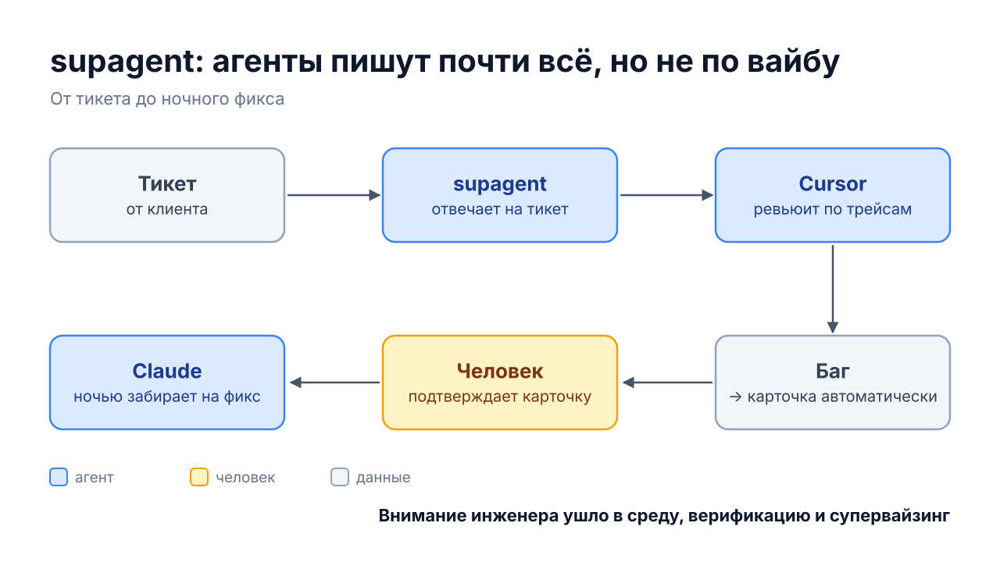

Реальный пример — supagent. Он отвечает на тикеты, каждый тикет по трейсам ревьюит Cursor, найденные баги автоматически становятся карточками, человек их подтверждает, а ночью их забирает на фикс Claude. **Агенты пишут почти всё, но ничего не происходит по вайбу.** Внимание инженера ушло из написания кода в среду, верификацию и супервайзинг.

### Spec-driven development: полувайбкод

**Слайд 21. Spec-driven development: полувайбкод**

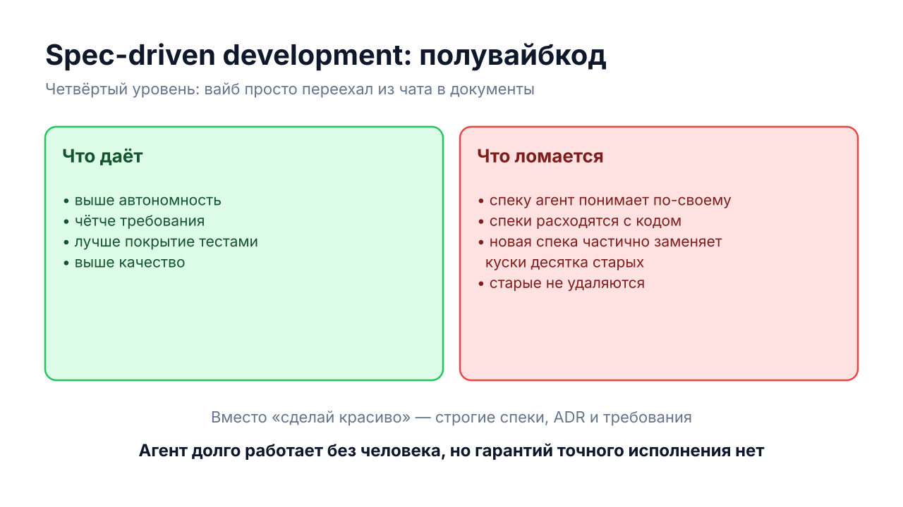

Но в разработке к этому я пришёл не сразу. Первой попыткой взять власть в свои руки и уйти от вайба был **spec-driven development**: вместо «сделай красиво» — строгие спеки, ADR, требования, по которым агент долго работает без вмешательства человека. Плюсы реальные: выше автономность, чётче требования, лучше покрытие тестами, выше качество. **Но по сути это полувайбкод, тот самый четвёртый уровень**: вайб просто переехал из чата в документы.

Проблемы здесь известные. **Спеку агент понимает по-своему**, и гарантий точного исполнения нет. А со временем спеки расходятся с кодом и начинают противоречить друг другу. Каждая новая спека не просто добавляет требования, а частично заменяет куски десятка старых. Старые при этом не удаляются и остаются в репозитории вместе с кодом, который им местами уже не соответствует.

**Слайд 22. Граф спек после ~90 изменений**

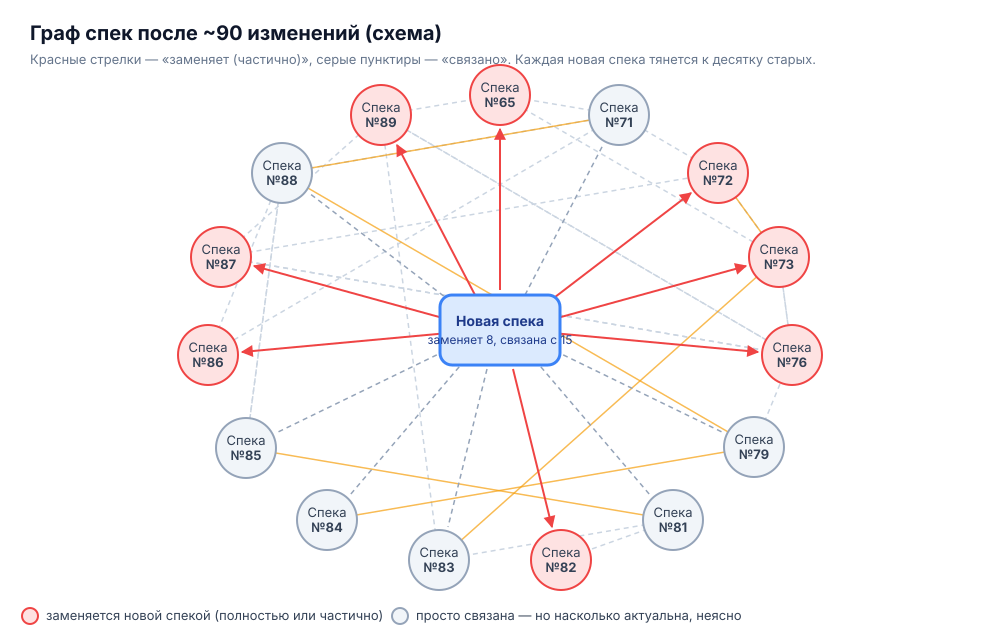

Масштаб на живом проекте: около 90 ADR, и в 86 из них встречается «заменяет» или supersede. Шапка одной из последних спек требует разобраться ещё в 15 документах. Чтобы понять текущее поведение, его приходится собирать из десятков документов с отношениями «заменяет частично». **Это путает и человека, и агента**: агент читает спеки разной степени устаревшести и выбирает не ту, а конфликты едят контекст.

**SDD умер.** Те, кто продолжит, умрут под тоннами разъехавшихся спек. Какой подход в разработке приходит ему на смену — TBD.

## 10. За пределами разработки: инфра-опс, саппорт, ассистент

**Слайд 23. Тот же принцип — за пределами разработки**

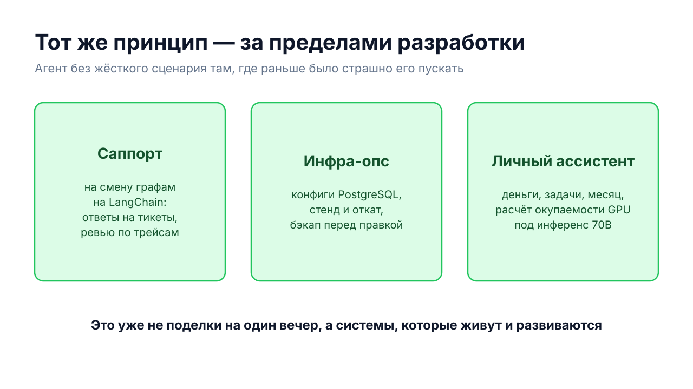

Принцип кодинг-агентов, когда сценария нет и путь выбирает сам агент, давно вышел за пределы разработки. В саппорте он пришёл на смену тем самым графам на LangChain, а дальше добрался до инфраструктуры и личного ассистента.

**Слайд 24. Агенту дают не один шанс, а стенд и откат**

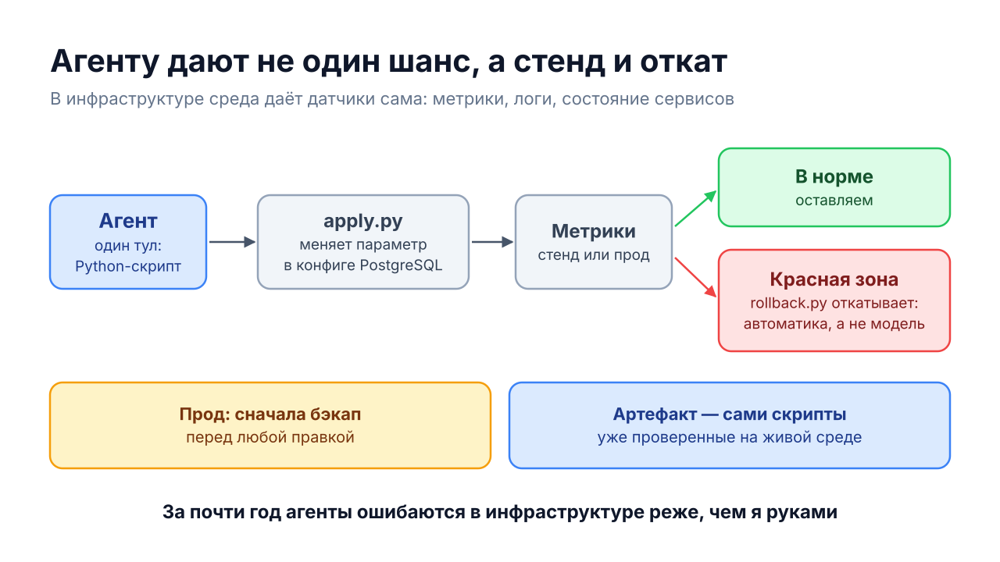

В разработке у цикла обратной связи есть датчики, но их приходится строить: тесты, стенды, CI. **В инфраструктуре среда даёт датчики сама**: метрики, логи, состояние сервисов. Поэтому дальше всего я продвинулся именно там, и именно там агентов боятся больше всего.

Агенту не дают один шанс. Ему дают **стенд и откат**. Пример: агент меняет параметр в конфиге PostgreSQL. Один простой скрипт его накатывает, такой же простой откатывает. Метрика ушла в красную зону — **откатывает автоматика, а не модель.** На проде перед любой правкой — сначала бэкап.

Мышление при этом другое. Вместо того чтобы заранее писать Terraform и спеки в отрыве от реальной инфраструктуры, я даю агенту **один тул: исполнить Python-скрипт**. Артефакт прогона — это и есть скрипты, уже проверенные на живой среде. Так быстрее. И если стоят хуки и границы тулов, **за почти год работы в инфраструктуре агенты ошибаются реже, чем я руками.**

Так я теперь работаю везде, где раньше было страшно пускать агента: **инфра-опс, саппорт, личный ассистент.** Пример задачи для ассистента — расчёт окупаемости собственного GPU под инференс 70B-модели. Это уже не поделки на один вечер, а системы, которые живут и развиваются.

### Personal OS: секретарь и коуч, которого я написал сам

**Слайд 25. Personal OS: как устроено**

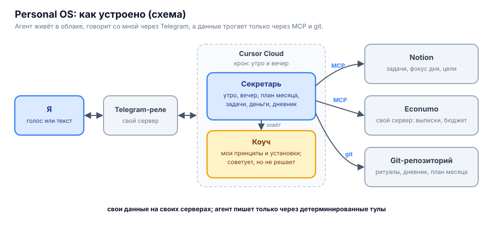

Самый неожиданный кейс — личный ассистент, по сути personal OS. Это облачный агент в Cursor со своим репозиторием, а разговаривает он со мной через Telegram, голосом или текстом. Сначала о том, что он делает за меня.

**Слайд 26. Один день Personal OS в Telegram**

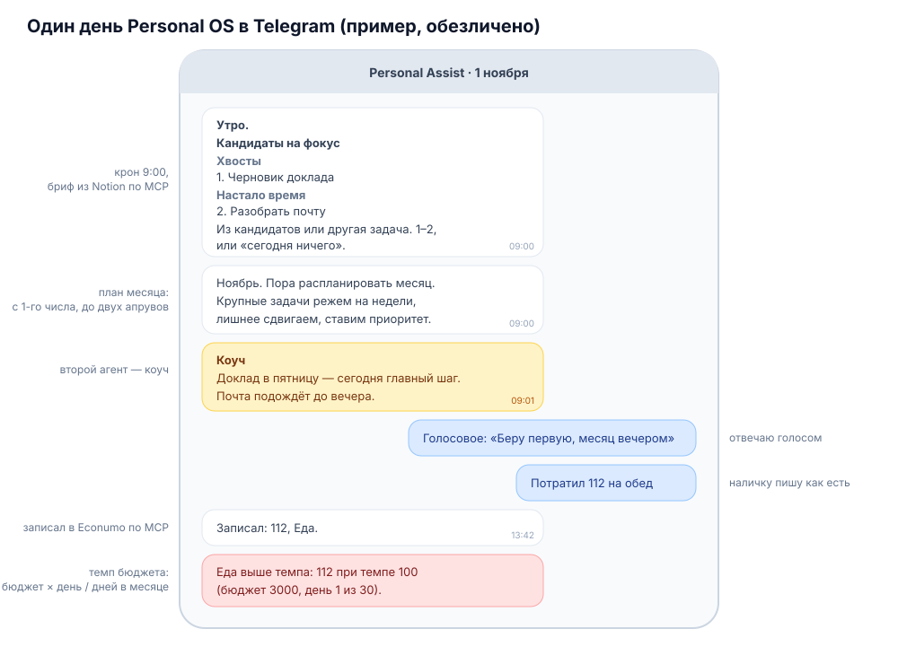

**Деньги.** Вся моя бухгалтерия лежит в self-hosted Econumo на отдельном сервере, туда загружена история за семь лет. На том же сервере агенту доступны банковские выписки: новые операции он забирает сам, раскладывает по категориям и записывает в Econumo по MCP. Мне остаются только спорные — наличка, переводы, непонятные мерчанты. Наличку пишу как есть: «потратил 112 на обед» — расход записан. Запись идёт через детерминированный тул, который проверяет курс, перечитывает счёт и подтверждает операцию. Он же сразу считает темп бюджета, и если категория обогнала месяц, приходит отдельное сообщение.

**Слайд 27. Задачи в Notion: от направления до подзадачи**

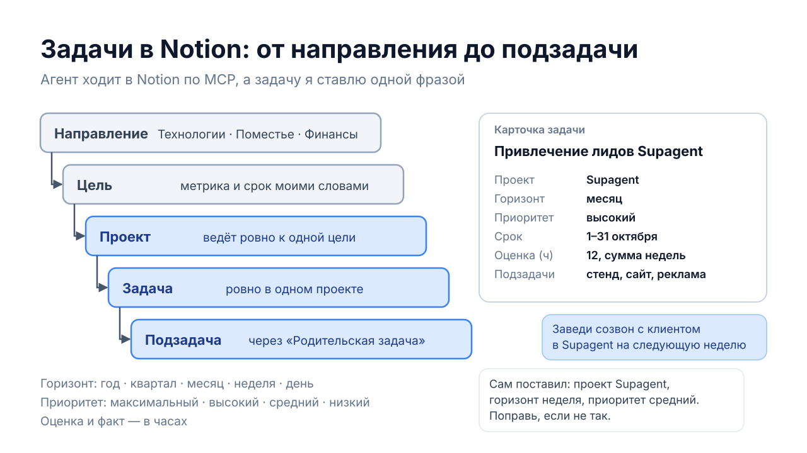

**Задачи.** Задачи живут в личном Notion, агент ходит туда по MCP. Устроено это лестницей: направление, цель, проект, задача, подзадача. Направлений три: технологии, поместье, финансы. Цель — это метрика и срок, которые я назвал сам. Проект ведёт ровно к одной цели, задача лежит ровно в одном проекте, подзадача висит на одной родительской задаче. У каждой карточки есть горизонт (год, квартал, месяц, неделя или день), один из четырёх приоритетов, срок и оценка в часах, а фактические часы копятся из вечерних отчётов. Задачу я ставлю одной фразой, обычно голосом: «заведи созвон с клиентом в Supagent на следующую неделю». Проект, родителя и горизонт агент выводит сам, если кандидат один, и в ответе перечисляет, что поставил. Спрашивает только там, где подходят два варианта, а неназванный приоритет — средний.

**День.** Каждое утро в 9:00 приходит бриф: цели и до восьми кандидатов на фокус — хвосты, просроченное, то, чему настало время. Я выбираю одну-две задачи, вечером он спрашивает, что сделано и сколько минут ушло.

**Слайд 28. План месяца: от напоминания до двух апрувов**

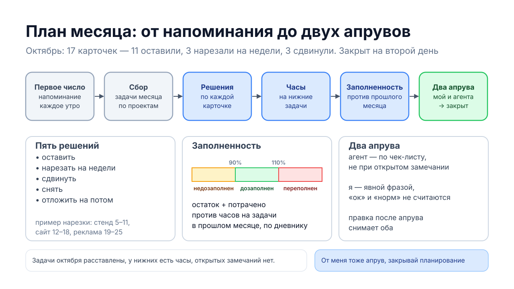

**Месяц.** С первого числа каждое утро приходит отдельное напоминание, пока месяц не закрыт. Агент собирает задачи, которые попадают в месяц по горизонту и сроку, и показывает их по проектам. То, что уже в работе или на паузе, в план не попадает. По каждой карточке я принимаю одно из пяти решений: оставить, нарезать на недели и подзадачи, сдвинуть, снять или отложить на потом. Нарезанные куски агент заводит сам и растягивает срок родителя до самого позднего ребёнка. Потом я называю чистое время на каждую нижнюю задачу, а оценка родителя — только сумма детей. Дальше проверка заполненности: остаток часов плюс уже потраченное агент сравнивает с тем, сколько часов на задачи реально ушло в прошлом месяце по дневнику. Плюс-минус 10% — месяц дозаполнен, иначе недозаполнен или переполнен.

Каждая дыра в плане — карточка без решения, без приоритета или без часов — это открытое замечание. **Закрывается месяц двумя апрувами: моим и агента.** Свой апрув агент ставит сам по чек-листу и не ставит, пока висит хоть одно замечание, даже если я прошу «апрувни». Мои «ок» и «норм» апрувом не считаются, нужна явная фраза про планирование. Любая правка доски после апрува снимает оба. Октябрь так и закрыли на второй день: 17 карточек, 11 оставили, три нарезали на недели, три сдвинули. Агент написал «задачи октября расставлены, у нижних есть часы, открытых замечаний нет», я ответил «от меня тоже апрув, закрывай планирование». Закрытый месяц так и остаётся закрытым: перенести карточку на ближайшую неделю — обычная правка, а не повод заново открывать планирование.

**Слайд 29. Коуч: та версия меня, которую я хочу растить**

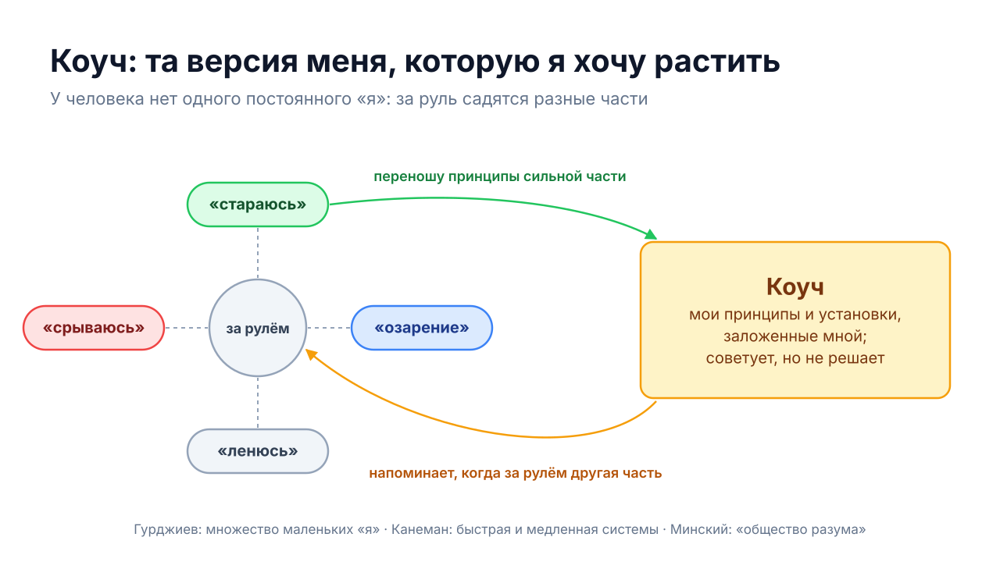

Но killer feature не в этом. **Агент меня усиливает.** В нём живёт коуч, которого я сам и создал, чтобы он направлял меня же.

Почему это работает. Ещё Гурджиев сто лет назад говорил, что у человека нет одного постоянного «я»: есть множество маленьких «я», и управление по очереди берёт то одно, то другое. Современная психология пришла к похожей картине: психика — это несколько подсистем, условно несколько нейросетей, которые конкурируют и конфликтуют между собой. Канеман описывал быструю и медленную системы мышления, Минский — «общество разума». Поэтому один день ты стараешься, другой срываешься, на третий ленишься, а потом снова озарение. **Это не ты непостоянный, это за руль садятся разные части мозга.**

Отсюда и подход. Ту часть себя, которую я хочу сделать сильнее, я переношу в искусственную нейросеть: её принципы закладываю сам. А потом она транслирует их мне обратно, в том числе в те дни, когда за рулём другая часть. **Так я усиливаю сильные стороны и ослабляю слабые.** Это уже не автоматизация задач, а психологический подход: агент как внешний носитель той версии меня, которую я хочу растить.

**Слайд 30. Жизнь после смерти начинается, когда снова включаешь голову**

Вайбкод — это смерть. **Жизнь после неё начинается, когда снова включаешь голову.**
